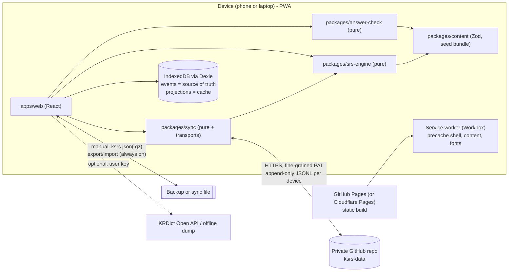

# ARCHITECTURE.md: 한국어 SRS (working name "ksrs")

A personal, single-user, local-first, WaniKani-style SRS for advanced Korean (TOPIK 5–6).
Status: v0.1 (initial architecture, pre-M1). Owner: the project owner. The architecture is maintained by the Architect agent. Changes to any public package API, or to the event or backup format, require an entry in `DECISIONS.md`.

---

## 1. Goals and non-goals

**Goals**
- About 45–60 min/day of study. Reviews are capped at roughly 45 min/day by a load estimator. The rest of the time goes to lessons and item pages.
- Production-heavy, register-aware practice: meaning, production, cloze, nuance pick, and register rewrite.
- Lenient but honest grading of free-form Korean, with a one-tap, audited self-grade override.
- Offline installable PWA with no accounts. Phone and laptop sync without our own server.
- All seed content is original. KRDict is an optional, attributed import.

**Non-goals (v1)**
- Multi-user support, social features, or a server-side database.
- Hanja reviews. Hanja are teaching nodes only.
- Speech recognition, handwriting, or AI grading.
- Background or push sync. iOS does not support it reliably, so sync runs on open, on session end, and manually.

---

## 2. Overview



**Core idea.** All user state is an append-only event log. Each event carries a UUIDv7, a device id, a hybrid logical clock (HLC), and a wall-clock time. SRS state, notes, settings, and custom items are projections derived by deterministically replaying the log. Merging two devices is a set union by event id, followed by a replay of the items that changed.

---

## 3. Stack choices

| Concern | Choice | Justification |
|---|---|---|
| Language/build | TypeScript 5 (strict), Vite 6, pnpm workspaces | Static output, fast, works on any host. pnpm workspaces give clean package boundaries. |
| UI | **React 19** + React Router (hash router) | Neither React nor Svelte fixes Hangul IME issues. IME bugs come from *controlled* inputs rewriting `value` mid-composition, and both frameworks hit that. We solve it once with an uncontrolled `<HangulInput>` (§8.6), so the framework is neutral on IME. React wins on multi-agent maintainability: it has the largest training corpus, stable idioms, React Testing Library, and `eslint-plugin-react-hooks`. With Svelte 5, agents often mix runes with Svelte 4 syntax. Bundle size does not matter much for a PWA that is cached once. |
| State | `dexie-react-hooks` `useLiveQuery` for persisted views; `useReducer` around the engine's pure session reducer | No Redux or Zustand needed. The DB is the store. |
| Storage | **IndexedDB via Dexie 4** | IndexedDB is mature in iOS Safari. SQLite-WASM persistence needs OPFS, and its fast VFS needs SharedArrayBuffer, which requires COOP/COEP headers that GitHub Pages cannot set. SQLite-WASM is about 1 MB of wasm versus about 30 KB gz for Dexie. Migrations are trivial because projections are rebuildable (§10). Forecast queries are an indexed range on `availableAt` over fewer than 10k rows, which takes under 5 ms. |
| Validation | Zod 4 | Content schemas, import validation, and event validation on sync ingest. |
| PWA | `vite-plugin-pwa` (Workbox `generateSW`, `registerType: 'prompt'`) | Standard and framework-agnostic. The prompt avoids reloading mid-review. |
| Styling | CSS Modules + CSS custom-property tokens; `prefers-color-scheme` plus a manual override | No runtime CSS-in-JS. Dark mode is a token swap. |
| Typography | **Pretendard Variable** for UI and Korean (Hangul is the visual focus) | Pretendard has no CJK ideographs; the one muted hanja line per vocab item falls back to `"Apple SD Gothic Neo", "Noto Sans KR"`. No serif hanja font (D63). |
| FSRS | `ts-fsrs` (pinned, MIT, pure TS) behind the `Scheduler` interface | Optional mode. |
| Tests | Vitest, fast-check (property tests), fake-indexeddb, Playwright (Chromium + WebKit) | §12. |
| Lint/format | ESLint (flat) + Prettier; `dependency-cruiser` for boundary rules | Enforces the package API boundaries in §4. |

---

## 4. Repository layout and ownership

```
ksrs/
├─ ARCHITECTURE.md  DECISIONS.md  CONTRIBUTING.md (agent rules)
├─ package.json  pnpm-workspace.yaml  tsconfig.base.json  .dependency-cruiser.cjs
├─ .github/workflows/ci.yml            # typecheck, lint, unit, content-validate, build, e2e
├─ .github/workflows/deploy-pages.yml  # build with BASE=/<repo>/ → GitHub Pages
├─ packages/
│  ├─ content/        # OWNER: Content agent
│  │  ├─ src/schema/*.ts      # Zod schemas → exported TS types
│  │  ├─ src/import/{json,csv,krdict}.ts
│  │  ├─ src/validate.ts      # referential + semantic validation
│  │  ├─ src/bundle.ts        # seed → content.bundle.json (+ hash, idRedirects)
│  │  ├─ seed/L01/{hanja,vocab,grammar,expressions}.json … L03/
│  │  └─ bin/validate-content.ts, bin/build-bundle.ts
│  ├─ answer-check/   # OWNER: Answer-check agent (deps: content types only)
│  │  └─ src/{normalize,jamo,distance,particles,features,dubeolsik,check}.ts
│  ├─ srs-engine/     # OWNER: Engine agent (deps: content types; ts-fsrs)
│  │  └─ src/{events,hlc,uuid7,replay,scheduler/{wk,fsrs},unlock,queue,
│  │          session,forecast,load,leech,questions,upcast}.ts
│  └─ sync/           # OWNER: Sync agent (deps: srs-engine event types)
│     └─ src/{segments,merge,syncOnce,transports/{github,file,memory}}.ts
├─ apps/web/          # OWNER: UI agent
│  └─ src/{db/,features/{dashboard,lessons,reviews,items,settings,import,sync},
│          components/HangulInput.tsx, tts/, pwa/, theme/}
└─ tests/
   ├─ e2e/            # OWNER: QA agent (Playwright)
   ├─ fixtures/       # event logs, two-device scenarios, golden answer tables
   └─ golden/answer-check.ko.tsv   # owner-reviewed grading cases
```

**Boundary rules (enforced by dependency-cruiser in CI)**
1. Packages are imported only through their `src/index.ts`. Deep imports fail CI.
2. `srs-engine`, `answer-check`, and `content/schema` are **pure**: no DOM, no IndexedDB, no `Date.now()`, no `Math.random()`. Clock and RNG are injected. No React.
3. `sync` defines its own `EventStore` and `SyncTransport` interfaces. It never imports Dexie. `apps/web` provides the adapters.
4. Only `apps/web/src/db` touches Dexie.
5. Event and backup formats live in `srs-engine/src/events.ts` and are frozen at M1. Changes require a version bump plus an upcaster.

Dependency direction: `content ← answer-check`, `content ← srs-engine ← sync ← apps/web`.

---

## 5. Data model (content)

Types are inferred from Zod. They are shown here as TS for clarity.

```ts
// packages/content/src/schema/types.ts
export type ItemId = string;            // "v:망설이다", "v:배:ship", "g:는-바람에", "x:눈코-뜰-새-없다", "h:決"
export type ItemKind = 'vocab' | 'grammar' | 'expression' | 'hanja';
export type ReviewableKind = Exclude<ItemKind, 'hanja'>;
export type QuestionType = 'meaning' | 'production' | 'cloze' | 'nuance' | 'register';
export type Register = 'formal' | 'written' | 'neutral' | 'spoken' | 'slang';
export type SpeechLevel = 'hapsyo' | 'haeyo' | 'hae' | 'haera' | 'written' | 'spoken';
export type ParticleTolerance = 'none' | 'allomorph' | 'loose';

export interface SourceInfo {
  kind: 'original' | 'krdict' | 'user' | 'import';
  license: 'original-owned' | 'CC-BY-SA-2.0-KR' | string;
  attribution?: string;     // required when license !== original-owned
  url?: string; retrievedAt?: string; krdictTargetCode?: number;
}
export interface UnlockDep { id: ItemId; require: 'lesson' | 'guru' }
export interface Example { ko: string; en: string; register?: Register; needs_review?: boolean }

interface ItemBase {
  id: ItemId; kind: ItemKind; level: number; track: string; rev: number;
  unlockDeps: UnlockDep[];  gating: boolean;           // hanja: always false
  source: SourceInfo; needs_review: boolean; tags: string[];
}

interface ReviewableBase extends ItemBase {
  kind: ReviewableKind;
  questionTypes: QuestionType[];        // 1–3; review completes when all are answered correctly
  questions: QuestionSpecs;             // acceptedAnswers per question type
}

export interface QuestionSpecs {
  meaning?:    { accepted: string[]; rejected?: string[] };          // EN; headword is the prompt
  production?: { promptEn: string; contextHint?: string; accepted: string[]; rejected?: string[] };
  cloze?:      ClozePrompt[];
  nuance?:     NuancePrompt[];
  register?:   RegisterPrompt[];
}
export interface ClozePrompt {
  id: string; sentence: string;          // exactly one "{{}}"
  en: string; cue: string;               // e.g. "쏟아지다 + -는 바람에"
  accepted: string[];                     // alternative conjugations allowed
  nearMiss?: { answer: string; hint: string }[];   // e.g. sibling pattern -는 통에
  particleTolerance: ParticleTolerance; spacingStrict?: boolean;
}
export interface NuancePrompt {
  id: string; situation: string;          // KO context, optionally with EN gloss
  options: { text: string; correct: boolean; why: string }[];  // 2–3, exactly one correct
}
export interface RegisterPrompt {
  id: string; from: SpeechLevel; to: SpeechLevel; source: string;
  accepted: string[];
  features: FeatureRule[];                // target-feature checks (§8.4)
  coreWords: string[];                    // content stems that must survive
  particleTolerance: ParticleTolerance; finalPunctOptional: boolean;
}
export type FeatureRule =
  | { kind: 'endsWith'; any: string[]; label: string }      // compared in jamo space
  | { kind: 'contains' | 'notContains'; any: string[]; scope?: 'lastEojeol' | 'all'; label: string };

export interface VocabItem extends ReviewableBase {
  kind: 'vocab'; word: string; meanings: string[]; pos: string; register: Register;
  hanjaBreakdown?: { syllable: string; hanja: string; hanjaId?: ItemId }[];
  collocations: { ko: string; en: string }[]; examples: Example[];   // 2–3
}
export interface GrammarItem extends ReviewableBase {
  kind: 'grammar'; pattern: string; meaning: string;
  attachment: { stem: 'V' | 'A' | 'N' | 'N이다' | 'V/A'; final?: 'vowel' | 'consonant' | 'ㄹ' | 'any';
                tense: 'present' | 'past' | 'future' | 'any'; form: string; example: string }[];
  nuance: string; contrasts: { id: ItemId; note: string }[]; examples: Example[];
}
export interface ExpressionItem extends ReviewableBase {
  kind: 'expression'; subtype: '관용구' | '속담' | '사자성어'; text: string; hanjaText?: string;
  meaning: string; literal: string; usage: string; examples: Example[];
}
export interface HanjaItem extends ItemBase {          // lesson-only, never scheduled
  kind: 'hanja'; char: string; hun: string; eum: string; meanings: string[]; mnemonic: string;
}
export type Item = VocabItem | GrammarItem | ExpressionItem | HanjaItem;

export interface ContentBundle {
  formatVersion: 1; contentVersion: string;   // sha256 of canonical JSON
  items: Item[]; idRedirects: Record<ItemId, ItemId>;
}
```

**Question instances** are built by the engine at queue time and passed to the checker:

```ts
export type QuestionInstance = { qid: string; itemId: ItemId; promptId?: string } & (
  | { qtype: 'meaning'; promptKo: string; accepted: string[]; rejected: string[] }
  | { qtype: 'production'; promptEn: string; contextHint?: string; accepted: string[]; rejected: string[] }
  | { qtype: 'cloze'; before: string; after: string; en: string; cue: string;
      accepted: string[]; nearMiss: {answer: string; hint: string}[]; particleTolerance: ParticleTolerance; spacingStrict: boolean }
  | { qtype: 'nuance'; situation: string; options: { key: string; text: string; why: string }[]; correctKey: string }
  | { qtype: 'register'; from: SpeechLevel; to: SpeechLevel; source: string; accepted: string[];
      features: FeatureRule[]; coreWords: string[]; particleTolerance: ParticleTolerance; finalPunctOptional: boolean }
);
```
`accepted` is merged with the user's own accepted answers (`userAnswer.add` events). `rejected` is merged with the headwords of every other vocab item, so 결재 typed for 결제 is caught (§8.5). The prompt for multi-prompt types rotates deterministically: `promptIndex = hash(itemId + reviewCount) % n`.

---

## 6. Event log (user state)

```ts
// packages/srs-engine/src/events.ts. FROZEN AT M1.
export type HLC = string;   // `${ms36.padStart(9,'0')}.${counter36.padStart(4,'0')}.${deviceId}`, lexicographically sortable
interface EventBase { id: string /*UUIDv7*/; v: 1; type: string; hlc: HLC; deviceId: string; at: number /*wall ms*/ }

export type AppEvent = EventBase & (
  | { type: 'lesson.completed'; itemId: ItemId }                       // includes hanja
  | { type: 'review.answer'; itemId: ItemId; qtype: QuestionType; promptId?: string;
      response: string; grade: 'correct' | 'incorrect';
      check: { layer: string; closeAttempts: number; matched?: string };
      requiredQTypes: QuestionType[]; durationMs: number;
      selfGraded?: true; overrides?: string /* event id it replaces */ }
  | { type: 'event.void'; targetId: string; reason: 'undo' }
  | { type: 'item.reset'; itemId: ItemId; toStage: 1 }                 // leech reset or resurrect burned
  | { type: 'note.set'; itemId: ItemId; field: 'meaning' | 'usage' | 'mnemonic'; text: string }
  | { type: 'userAnswer.add' | 'userAnswer.remove'; itemId: ItemId; qtype: QuestionType; answer: string }
  | { type: 'settings.set'; key: SettingKey; value: unknown }
  | { type: 'customItem.upsert'; item: Item }                           // user, CSV, and KRDict items
  | { type: 'customItem.delete'; itemId: ItemId }
);
```

**Ordering and determinism.** Total order is `(hlc, id)`. The HLC absorbs clock skew between devices: on ingest, the local clock advances past the max remote HLC. Replay is a pure function of `(contentBundle, sortedEvents)`.

**Why events cover everything.** Settings, notes, and custom items become last-writer-wins registers for free: the latest HLC per `(key)`, `(itemId, field)`, or `(itemId)` wins. One merge mechanism covers all state, which fully satisfies the requirement that non-log state use LWW. `note.set` is emitted on blur or after 2 s idle, never per keystroke.

**SRS settings are time-indexed.** `settings.set` for `srs.intervals` or `srs.scheduler` applies only to reviews whose HLC is later. Replay never rewrites history when intervals change.

**Close attempts are not events.** A "close" result triggers a retry. The count is stored in the eventual answer's `check.closeAttempts`.

**Extra study and lesson quizzes emit no events.**

### 6.1 Replay semantics per item

The stage of an item depends only on that item's events plus the SRS-settings timeline. This lets us replay per item locally.

1. Drop voided events. A `review.answer` with `overrides: X` also voids `X`.
2. `lesson.completed` sets stage 1 and `availableAt = floorHour(at + interval[1])`.
3. **Dueness gate.** A `review.answer` takes effect only if `at ≥ availableAt − 5 min`. Otherwise it is recorded as `ignoredEarly`: it counts toward leech statistics if it was incorrect, but it does not change the stage. This resolves the case where both devices review the same due item offline. The first by HLC wins, and the second becomes a no-op. The case is rare and the result is deterministic.
4. **Pending group.** Answers accumulate in a pending group until every qtype in `requiredQTypes` (taken from the latest answer in the group) has at least one correct answer. The item completes at that answer's `at`, with `incorrect = count(grade==='incorrect')` in the group.
5. Apply `Scheduler.next()` (§7.1). If the stage reaches 5 for the first time, set `passedAt`.

### 6.2 Undo and overrides under sync

- **Undo** emits `event.void{targetId}`. The UI offers it only for the most recent answer in the current session. The engine supports voiding any answer. Voids sync like any other event. A device that already synced the target simply replays without it. A void of a void is rejected by validation.
- **"I was right"** emits a new `review.answer{grade:'correct', selfGraded:true, overrides: wrongId}`. It is visible in history and in stats (self-grade rate per qtype). An optional checkbox, "Accept this answer in future", also emits `userAnswer.add`.

---

## 7. SRS engine

### 7.1 Stages and WaniKani formula

Stages: `0` lesson pending, `1–4` Apprentice 1–4, `5–6` Guru 1–2, `7` Master, `8` Enlightened, `9` Burned.
Default `intervals` (applied on *reaching* stage s, s = 1..8): `[4h, 8h, 1d, 2d, 1w, 2w, 30d, 120d]`. `availableAt` is rounded down to the hour.

```
if incorrect == 0:  new = min(9, s + 1)
else:               adj = ceil(incorrect / 2)
                    penalty = (s >= 5) ? 2 : 1
                    new = max(1, s - adj * penalty)
```

Examples:
- Master (7) with 1 wrong goes to 5 (Guru 1).
- Enlightened (8) with 3 wrong: adj 2 × penalty 2 = 4, so it goes to 4 (Apprentice 4).
- Apprentice 3 with 1 wrong goes to 2.
- Guru 2 (6) with 2 wrong goes to 4.

`incorrect` counts every wrong submission across all question types in the group.

### 7.2 Public API (packages/srs-engine)

```ts
export interface Scheduler {
  id: 'wk' | 'fsrs';
  next(state: SrsCore, outcome: { incorrect: number; closeAttempts: number; at: number },
       params: SrsParams): SrsCore;                       // pure
  isGuruOrAbove(state: SrsCore): boolean;                 // FSRS: scheduled interval ≥ 7d
}
export interface SrsCore { stage: Stage; availableAt: number | null; fsrs?: { s: number; d: number; due: number } }

export interface ItemState extends SrsCore {
  itemId: ItemId; kind: ItemKind; level: number;
  lessonAt?: number; passedAt?: number; burnedAt?: number;
  pending: { answered: QuestionType[]; incorrect: number; since: number } | null;
  stats: { reviews: number; correct: number; incorrect: number; streak: number; lastAt?: number; selfGraded: number };
  leechScore: number;
}
export interface DerivedState {
  items: Map<ItemId, ItemState>; userLevel: number;
  unlocked: Set<ItemId>; notes: Map<string, string>; settings: Settings;
  userAnswers: Map<string, string[]>; customItems: Map<ItemId, Item>; lastHlc: HLC;
}

// replay
export function replayAll(content: ContentBundle, events: AppEvent[]): DerivedState;
export function applyEvents(prev: DerivedState, content: ContentBundle, all: AppEvent[],
                            newEvents: AppEvent[]): { state: DerivedState; changed: ItemId[] };
// unlock and levels
export function computeUnlocks(content: ContentIndex, items: Map<ItemId, ItemState>): { userLevel: number; unlocked: Set<ItemId> };
export function levelProgress(content: ContentIndex, s: DerivedState, level: number):
  { gatingTotal: number; gatingPassed: number; threshold: number /*0.9*/; unlocksNext: boolean };
// lessons and load
export function availableLessons(content: ContentIndex, s: DerivedState): ItemId[];   // ordered
export function dailyLessonCap(s: DerivedState, events: AppEvent[], now: number, st: Settings): LessonCapReport;
// reviews and session
export function dueItems(s: DerivedState, now: number): ItemId[];
export function buildQuestions(item: Item, s: DerivedState, enabled: QuestionType[], seed: string): QuestionInstance[];
export function sessionReducer(sess: ReviewSession, action: SessionAction): { sess: ReviewSession; emit: AppEvent[] };
// dashboard
export function forecast(s: DerivedState, now: number, horizonH: 24 | 168, bucket: 'hour' | 'day'): { t: number; count: number; cumulative: number }[];
export function stageCounts(s: DerivedState): Record<'apprentice'|'guru'|'master'|'enlightened'|'burned', number>;
export function troubleItems(s: DerivedState, limit?: number): { itemId: ItemId; score: number }[];
// infra
export function createHlc(deviceId: string, clock: () => number): { now(): HLC; observe(remote: HLC): void };
export function uuidv7(clock: () => number, rng: () => number): string;
export function upcastEvent(raw: unknown): AppEvent | { unknownFutureVersion: true; raw: unknown };
```

### 7.3 Unlock logic (two paths; hanja are not lesson nodes)

- **Hanja are not lesson nodes** (D63, supersedes D12). `availableLessons` never returns hanja items (content, custom or imported), hanja are never unlocked, and deps on hanja (implicit `hanjaBreakdown` deps or explicit ones) don't apply. Old `lesson.completed` events for hanja ids replay harmlessly: the item gets `lessonAt` only and is never counted (levels, caps, forecast, stage counts, due). A vocab item's hanja show as one muted line on its page. `settings.set hanja.lessons = true` is an engine-only rollback hook; the UI has no hanja lessons or pages.
- **Vocab path** (vocab + expressions). Its levels are the levels holding a non-grammar item. Level 1 is open at start; **level N+1 opens at ≥ 90% of level N's gating vocab and expression items** with `passedAt` set (first Guru, sticky).
- **Grammar path** (grammar only). Its stages are the distinct `level` values of grammar items, ascending (gaps are fine: 1, 2, 3, 5, 6, 7). Stage 1 is open at start; **stage k+1 opens at ≥ 90% of stage k's gating grammar items passed**. Neither path's progress opens the other. `grammarProgress(index, state)` reports every stage; `DerivedState.grammarStage` is the highest open one.
- Within an open level/stage, explicit `unlockDeps` still apply, e.g. `-는 통에` requires `{g:는-바람에, require:'guru'}`.
- Lesson queues: `availableLessons(index, s, { path })`. `vocab` = everything except grammar, by level, kind order (vocab, expression), content order, with imported extras interleaved 3:2 (D60). `grammar` = grammar by level, then content order.
- `grammar.separatePath = false` restores the combined behaviour: one ladder over all levels, gating counts vocab, grammar and expressions, one lesson queue.

### 7.4 Lessons and load estimator

Lessons come in batches of `settings.lessonBatch` (default 5). Each batch has teach pages, then a lesson quiz (no events). Passing the quiz emits `lesson.completed` for each item.

Daily caps (`dailyLessonCap`): **one review budget T** (`targetReviewMin`, 45 min), **two caps**, reported as `cap` (vocab path) and `grammar.cap` in the `LessonCapReport`:
- `secPerQ[qtype]` is the EMA of `durationMs` (clamped to 3–120 s). Defaults: meaning 7, production 10, cloze 14, nuance 18, register 40.
- `itemCost = Σ_required secPerQ × (1 + (1 − acc))`, where `acc` is the rolling 30-day accuracy (default 0.85). Each path averages over its own next items (`c_v`, `c_g`), so grammar is costed at its real question types.
- `rpi` (reviews per item) = 8 / acc ≈ 9.4.
- **Grammar first.** `limit_g = min(grammar.dailyLessons (default 3), ⌊T / (rpi·c_g)⌋, grammar headroom)`; `grammar.cap = limit_g − grammar lessons done today`. Its projected cost is **reserved**: `reserved = max(doneToday_g, min(limit_g, doneToday_g + available_g))` (grammar that can't happen today reserves nothing).
- **Vocab in what's left.** Steady: `n_v = ⌊(T − reserved·rpi·c_g) / (rpi·c_v)⌋`. Headroom (7-day success-path simulation of existing items; a new item adds reviews at +4h, +12h, +1.5d, +3.5d): `n_v = min_d ⌊(T − proj_d − adds_d·reserved·c_g) / (adds_d·c_v)⌋`.
- `cap = clamp(min(steady, headroom) − vocabLessonsDoneToday, 0, maxLessonsPerDay = 20)`. Items learned today are excluded from the projection (D44). If due reviews exceed 1.5 × T, both caps are 0 ("clear reviews first"). "Today" uses `dayStartHour` (4:00 local). "+5 anyway" raises the vocab day total (D45).
- Example (defaults, nothing learned, vocab = meaning+production, grammar = meaning+cloze): `c_v = 17 × 1.15 = 19.55 s`, `c_g = 21 × 1.15 = 24.15 s`, `rpi = 9.41`. Grammar reserves 3 × 9.41 × 24.15 ≈ 682 s, so vocab steady = ⌊(2700 − 682) / 184⌋ = 10 (it would be 14 with no grammar allowance).
- Grammar misses also open **ghost reviews** at +2 h and +24 h (derived from the log, practice-only `extra` sessions with no events; done-state per device in kv; slots lapse after 7 days).
- Combined mode (`grammar.separatePath = false`): the original single cap over all non-hanja lessons.

### 7.5 Leeches, extra study, FSRS

- `leechScore = incorrectLast90d / max(1, streak)^1.5`. An item is a leech if the score is ≥ 3 and it has had ≥ 4 reviews. The trouble list is sorted by score, with actions: add a mnemonic note, reset to Apprentice 1 (`item.reset`), or drill in extra study.
- **Extra study** draws from recent lessons, the trouble list, or a level/kind filter. It uses the same UI and checker, emits no events, and is labeled "practice — not scheduled".
- **FSRS mode** maps outcomes as follows: 0 incorrect and 0 close → Good; 0 incorrect with ≥1 close → Hard; any incorrect → Again. For display, stages derive from the interval: `<1d` A1–4 by review count, `≥7d` Guru, `≥30d` Master, `≥120d` Enlightened, `≥365d` Burned. Gating uses `isGuruOrAbove`. Switching modes is a time-indexed `settings.set`.

---

## 8. Answer checking (packages/answer-check)

```ts
export type Outcome = 'correct' | 'close' | 'incorrect';
export interface CheckResult { outcome: Outcome; layer: Layer; matched?: string; distance?: number; hint?: string; notes: string[] }
export function check(q: QuestionInstance, response: string): CheckResult;     // pure, < 2 ms
export function normalizeKo(s: string, o?: { stripFinalPunct?: boolean }): string;
export function normalizeEn(s: string): string;
export function toJamo(s: string): string[];                 // fully decomposed (§8.2)
export function jamoDistance(a: string, b: string): number;  // weighted Levenshtein
export function dubeolsikToHangul(ascii: string): string;    // "rkskek" → "가나다"
```

### 8.1 Normalization
- **Korean.** NFC. Convert full-width to ASCII. Normalize curly to straight quotes. Convert `…` to `...`. Collapse whitespace and trim. Remove zero-width characters. Convert compatibility jamo to standard. Optionally strip sentence-final `. ! ? ~ …` (always for production and cloze; per prompt for register).
- **English.** Lowercase. Strip parentheticals `(of a person)`. Strip leading `to ` / `a ` / `an ` / `the `. Strip punctuation and collapse spaces. Apply a small US/UK spelling map. Each `meanings[]` entry and each slash-alternative is a separate target.

### 8.2 Jamo decomposition and distance
- Decompose syllables into initial, medial, and final (U+AC00 arithmetic). Then decompose compound vowels (ㅘ→ㅗㅏ, ㅙ→ㅗㅐ, ㅚ→ㅗㅣ, ㅝ→ㅜㅓ, ㅞ→ㅜㅔ, ㅟ→ㅜㅣ, ㅢ→ㅡㅣ) and compound finals (ㄳ ㄵ ㄶ ㄺ ㄻ ㄼ ㄽ ㄾ ㄿ ㅀ ㅄ → pairs). Tense initials (ㄲ ㄸ ㅃ ㅆ ㅉ) stay single.
- Weighted Levenshtein: insert, delete, and substitute cost 1. **Confusable substitutions cost 0.5**: ㅔ/ㅐ, ㅖ/ㅒ, plain/tense pairs (ㄱ/ㄲ…), ㅓ/ㅗ.
- **Korean close tolerance** by target jamo length L: L ≤ 6 → 1; ≤ 12 → 1.5; ≤ 20 → 2; else min(4, 0.1L). Distance 0 is correct, within tolerance is **close**, and anything else is incorrect.
- **English typo tolerance** by normalized length n: ≤ 3 → 0; 4–5 → 1; 6–7 → 2; ≥ 8 → min(4, ⌊0.25n⌋). Within tolerance is **correct with a "typo" note**, as in WaniKani. English has no close outcome except for wrong script.

### 8.3 Layered pipeline (production, cloze, register)

| # | Layer | Result |
|---|---|---|
| 0 | Script: Latin letters in a KO field → try `dubeolsikToHangul`. A meaning field containing Hangul → close "answer in English". | Close ("switch keyboard"), with the converted text pre-filled |
| 1 | Normalize | n/a |
| 2 | `rejected` / other-item headword exact match | **incorrect**, hint names the other word |
| 2b | `nearMiss` match (cloze) | **close** + specific hint |
| 3 | Exact match vs `accepted ∪ userAccepted` | **correct** |
| 4 | Spacing-insensitive match | correct + note "띄어쓰기: …" (`spacingStrict` → close) |
| 5 | Particle canonicalization (`allomorph`: 은=는, 이=가, 을=를, 와=과, (으)로; `loose`: also 은/는↔이/가 and dropped particles) | Correct if equal under tolerance. A *wrong* allomorph for the preceding final consonant (책를) is close. |
| 6 | **Target features + core words** (cloze and register) | §8.4 |
| 7 | Min `jamoDistance` to accepted ≤ tolerance | **close** + diff-based hint |
| 8 | Otherwise | **incorrect** + best-match reveal |

Nuance pick is multiple choice: correct or incorrect, with every option's `why` shown afterward.

### 8.4 Target-feature check (lenient variant acceptance)

1. All `features` must hold. `endsWith` and `contains` compare in **jamo space**, so `ㅂ니다` matches 갑니다/겁니다 and `습니다` matches 먹습니다. A missing feature is **incorrect** with the feature's `label` as the hint (it is the skill being tested). If the response is within 1 jamo of satisfying the feature, it is **close**.
2. Every `coreWords` stem must appear. Exact substring is OK. A fuzzy match (best window similarity ≥ 0.75, where sim = 1 − d/maxLen) downgrades the result to **close**. A missing stem is **incorrect** ("content changed").
3. If 1 and 2 pass exactly and the similarity to the nearest accepted answer is ≥ 0.7, the result is **correct, layer `variant`**. These go to a "Variants inbox" so the owner can promote them into content with one tap. As a copyeditor's audit trail, this is a natural fit.

### 8.5 Worked examples

| Question | Accepted | Response | Outcome / layer |
|---|---|---|---|
| meaning: 망설이다 | to hesitate | `Hesitate` | correct / exact (the "to " is stripped) |
| meaning: 망설이다 | to hesitate | `hesitat` | correct / typo (n=8, d=1) |
| production: "payment (settling a bill)" | 결제 | `결재` | **incorrect** / rejected: "결재 = approval (sign-off)" |
| production: "pillow" | 베개 | `배개` | **close** / jamo d=0.5 ≤ 1, hint "check ㅔ/ㅐ" |
| production: "to hesitate" | 망설이다 | `망서리다` | **close** / d=1 (missing ㅇ, resyllabified) |
| production: "to hesitate" | 망설이다 | `akdtjfdlek` | close / wrong script → shows 망설이다, "switch to Korean keyboard" |
| cloze: 비가 갑자기 {{}} 우산도 없이 뛰어야 했다. (쏟아지다 + -는 바람에) | 쏟아지는 바람에 | `쏟아지는바람에` | correct / spacing (+ 띄어쓰기 note) |
| same | same | `쏟아지는 통에` | **close** / nearMiss: "Valid sibling, but target is -는 바람에 (neutral cause); -는 통에 implies chaotic circumstances" |
| register 해요→합쇼: 내일 회의에 참석할 거예요. | 참석할 것입니다 / 참석하겠습니다 (with 내일 회의에) | `내일 회의에 참석할 겁니다.` | **correct** / variant (ends ㅂ니다 ✓, core 내일·회의·참석 ✓, sim 0.86) |
| same | same | `내일 회의에 참석할 거에요` | **incorrect** / feature: "Ending must be 합쇼체 (-ㅂ니다/-습니다)" |
| same | same | `내일 회의에 참성할 것입니다` | **close** / core word fuzzy (참석 vs 참성) |
| written→spoken: 그러나 그 계획은 실현되지 않았다. | 근데 그 계획은 실현이 안 됐어요 / 그런데 … 실현 안 됐어요 | `근데 그 계획 실현 안 됐어요` | correct / particle (`loose`: 은 dropped) + variant |
| same (feature `notContains 그러나`, `endsWith 요`) | same | `그러나 그 계획은 실현 안 됐어요` | incorrect / feature: "그러나 is written register" |

After any incorrect result, the UI shows **"I was right"**, which emits an override (§6.2), and Undo.

### 8.6 Hangul input and IME (`apps/web/src/components/HangulInput.tsx`)
- **Uncontrolled** `<input>` with a ref. React never writes `value` during composition. Attributes: `lang="ko"` (EN fields use `lang="en"`), `autocapitalize="off" autocorrect="off" autocomplete="off" spellcheck={false} enterkeyhint="done"`.
- Track `composing` via `compositionstart` and `compositionend`. Submit through a `<form onSubmit>`, which fires after commit on Android Gboard, where keydown reports `key: 'Unidentified'` / 229.
- On `keydown Enter` while `e.isComposing || keyCode === 229`: set `submitPending` and submit on the next `compositionend` (iOS Safari fires compositionend after Enter), with a 50 ms microtask fallback.
- Read `ref.current.value` only at submit, then run `normalizeKo`. The Playwright IME tests use CDP `Input.imeSetComposition` on Chromium, plus synthetic composition events on WebKit.

---

## 9. Content pipeline

1. **Authoring.** Seed JSON lives in `packages/content/seed/LNN/*.json`, written by the Content agent and fully original. IDs are stable and readable; homographs get a disambiguator (`v:배:ship`).
2. **Validation** (`pnpm content:validate`, runs in CI):
   - Zod schema checks.
   - Unique ids.
   - Every reference resolves (unlockDeps, hanjaBreakdown, contrasts).
   - No dependency cycles. Deps have level ≤ the item's level.
   - Exactly one `{{}}` per cloze. Nuance prompts have exactly one correct option.
   - Attribution is present when the license is not owned.
   - **Self-check:** every `accepted` answer grades *correct* through `answer-check`; every `rejected`/`nearMiss` does *not*.
   - The report lists counts of `needs_review` items.
3. **Bundle** (`pnpm content:bundle`) writes `content.bundle.json` with `contentVersion = sha256` and `idRedirects` (renamed ids keep their history). The app loads the bundle into Dexie `content` when the hash changes. User data is untouched because it lives in events.
4. **Seed scope (M2):** 3 levels, about 30 hanja (10 per level), 120 vocab (40 per level), 30 grammar (10 per level), 20 expressions (7/7/6). Policy (D15): every item passes the QA & Linguistic Review agent first, and **only items it can't confidently clear start `needs_review: true`**. Each level also gets a short owner skim-and-approve pass. The owner clears them in an in-app "Review content" list, which writes a patch file the owner commits. Badges appear on item pages.
5. **Import (M5):**
   - JSON in the bundle format, or CSV with one file per kind, `|` for multi-values, and header-defined columns.
   - Imports are validated, previewed with a diff, and then stored as `customItem.upsert` events, so they sync.
   - **KRDict:** the user pastes an API key, stored in the Dexie `secrets` store and never exported. Search, pick a sense, and get a draft vocab item with `source: {kind:'krdict', license:'CC-BY-SA-2.0-KR', attribution:'한국어기초사전 (국립국어원)', url, krdictTargetCode}`. If the API is not CORS-accessible from the browser, the importer accepts the official KRDict downloadable dictionary file instead. KRDict-derived items are **never** committed to the public app repo.

---

## 10. Storage (Dexie)

```ts
db.version(1).stores({
  events:      '&id, hlc, [itemId+hlc], type, deviceId, pushed',   // SOURCE OF TRUTH
  itemState:   '&itemId, availableAt, stage, [level+kind], passedAt, leechScore', // projection
  content:     '&id, level, kind, needs_review',                    // bundle + custom (projection)
  kv:          '&key',   // projections: settings, notes, userAnswers; meta: deviceId, hlc, schema, contentVersion
  syncState:   '&path',  // remote blob sha, line count, last sync
  quarantine:  '&id',    // malformed or future-version remote events (kept, never dropped)
  secrets:     '&key',   // github PAT, krdict key: excluded from backups and exports
});
```

- Forecast: `itemState.where('availableAt').between(now, now + 7d)`, then bucket in memory.
- **Migrations.** Projection stores can always be cleared and rebuilt with `replayAll`, which takes about 300 ms for 50k events. A Dexie version bump either transforms `events` (rarely) or sets `needsRebuild`. Settings has a "Rebuild from log" button.
- Startup calls `navigator.storage.persist()`. iOS note: an installed home-screen PWA has storage separate from Safari tabs. Onboarding says "install first", and sync or backup moves data across.

---

## 11. Sync design

### 11.1 Transport evaluation

| Option | Pros | Cons | Verdict |
|---|---|---|---|
| (a) GitHub private repo + **fine-grained PAT scoped to one repo, Contents R/W** | No server. CORS-enabled API. Least privilege (one repo). Git history is a free off-site backup. The owner is already getting GitHub for Pages. 5k req/h. | PAT entry is manual and the token expires (we remind 14 days before). The token lives in the browser. | **Chosen** |
| (a′) Gist | Simpler API | Fine-grained gist permission covers *all* gists. Large files truncate in the API. | Rejected |
| (b) Google Drive appDataFolder | Hidden folder, nice UX | Needs a Google Cloud project and consent screen. Browser-only flows get short-lived tokens with no refresh, so re-auth popups are frequent and they are flaky in iOS standalone PWAs. | Rejected for v1 |
| (c) Cloudflare Worker + R2/KV | Best UX, small cost | It is our own always-on server: auth, secrets, and ops. | Deferred; the `SyncTransport` interface makes it a drop-in |
| (d) Manual file export/import | Always works, offline | Manual | **Always kept** |

### 11.2 Remote layout (repo `ksrs-data`, private)

```
ksrs/v1/manifest.json                      { format: "ksrs-sync", version: 1 }
ksrs/v1/devices/<deviceId>.json            { name, lastSeen, appVersion }
ksrs/v1/log/<deviceId>/<YYYY>-W<ww>.jsonl  one event per line, append-only, ≈ ≤ 500 KB/week
```

Each device writes **only its own files**, so remote write conflicts are impossible across devices. Two tabs on the same device are serialized with `navigator.locks.request('ksrs-sync')`, plus a sha-mismatch retry that re-reads and unions by id.

### 11.3 Algorithm (`syncOnce(store, transport, clock)`)
1. `GET /git/trees/HEAD?recursive=1` (one request) gives each path and blob sha.
2. For each foreign `log/*` file whose sha changed: fetch the raw blob and parse only the lines past the cached line count. Then upcast, Zod-validate, and `hlc.observe()`. Valid events are bulk-put, ignoring existing ids; invalid ones go to quarantine.
3. Push local events where `pushed=0`, grouped by week: GET own file (sha), append lines, PUT with sha. On 409/422, refetch, union, and retry (up to 3 times). Then mark them pushed.
4. `applyEvents` over the changed items. Unlocks and level are recomputed. A full replay runs only if an SRS `settings.set` arrived.
5. Compare server `Date` headers. If clock skew exceeds 5 min, show a warning banner.

**Triggers:** app open, end of a review or lesson session, `visibilitychange→hidden` (best effort), and a manual button. There is no polling.
**Security:**
- CSP `connect-src 'self' https://api.github.com https://krdict.korean.go.kr`.
- No third-party scripts.
- The PAT lives in `secrets` and is never exported. Settings shows the token expiry.

**Manual sync (d)** uses the backup format below. Import is always a union merge, so "export on phone, import on laptop" has the same semantics as GitHub sync.

**Merge properties (property-tested):** union is commutative, associative, and idempotent, and replay(sort(union)) is independent of arrival order.

---

## 12. Backup format and migrations

```json
{
  "format": "ksrs-backup", "formatVersion": 1,
  "createdAt": "2026-10-16T12:00:00Z", "app": { "version": "0.5.0", "contentVersion": "sha256:…" },
  "deviceId": "…", "eventCount": 12345,
  "events": [ /* AppEvent[] sorted by (hlc,id) */ ],
  "checksum": "sha256:<of canonical events JSON>"
}
```

- Files are `.ksrs.json`, or `.ksrs.json.gz` via `CompressionStream`. Custom, CSV, and KRDict items are already events, so **a backup is just the log**. There are no projections and no secrets.
- **Restore modes:** *Merge* (default, a union) or *Replace* (wipe local, typed confirmation). Replace with sync enabled warns that remote history will re-merge. Starting fresh means a new sync namespace (`ksrs/v2-<date>`).
- **Versioning:**
  - Each event has a `v`. `upcastEvent` chains vN→vN+1 as pure functions. Writers always write the current version.
  - Events from a newer app are stored in quarantine and listed. The app prompts "update app" and never drops them.
  - `formatVersion` has its own upcasters.
  - Content renames go through `idRedirects`, which replay resolves.

---

## 13. PWA and offline strategy

- **Precache** (Workbox `generateSW`): app shell, JS/CSS, `content.bundle.json`, Pretendard Variable woff2, the Hanja subset font, and icons. `navigateFallback: index.html`.
- **Hash routing** (`#/reviews`) means no server rewrites. Vite `base` comes from env: `/<repo>/` on GitHub Pages and `/` on Cloudflare Pages. The manifest uses relative `start_url: "./"` and `scope: "./"`, plus `display: standalone`, `lang: ko`, theme colors per scheme, and apple-touch-icon.
- **Updates:** `registerType: 'prompt'`. A toast says "Update ready, reload when done." The app never auto-reloads during a session. Answers are durable events, so a reload mid-session loses nothing, and pending groups resume (§6.1).
- **TTS:**
  - Uses `speechSynthesis` with a voice where `lang.startsWith('ko')`, loaded after `voiceschanged`.
  - iOS requires a first user gesture, so playback is attached to a tap.
  - Rate is a setting. The button is hidden if no Korean voice exists. Auto-play after a correct production answer is optional.
- **Dark mode:** CSS tokens with `prefers-color-scheme` and a manual override (`settings.set theme`).

---

## 14. Testing strategy

| Layer | Tooling | Must cover |
|---|---|---|
| srs-engine | Vitest + fast-check, ≥ 95% line coverage | Formula table (§7.1) for every stage × incorrect 0–4. Interval/time-indexed settings. Dueness gate. Pending groups across devices. Unlock and 90% gating. Hanja never queued. Load-cap math. **Properties:** shuffle-invariance of replay, union idempotence and commutativity, `X then void(X) ≡ ∅`, override ≡ correct, stage ∈ [0,9]. Replay of 50k events < 500 ms (perf test). |
| answer-check | Vitest, 100% branch coverage on normalize/jamo | Unit tests per layer, plus `tests/golden/answer-check.ko.tsv` (question, response, expected outcome). The owner adds cases from real "I was right" overrides. |
| content | `content:validate` in CI | Schema, references, cycles, self-check, attribution. |
| sync | Vitest with an in-memory GitHub fake | Two-device scenarios: concurrent offline reviews, undo after sync, sha conflict retry, quarantine, truncated lines. |
| web | RTL + fake-indexeddb; Playwright (Chromium, WebKit, mobile viewport) | Lessons → reviews → dashboard flows. IME composition submit. Undo / "I was right". Offline reload (SW). Backup round-trip. |

CI blocks merge on typecheck, lint, boundaries, unit, content-validate, build, and e2e.

---

## 15. Milestones and acceptance criteria

**M1: Engine, schema, event format, answer-check core (no UI)**
- The event and backup formats in §6/§12 are implemented and frozen. HLC and UUIDv7 have injected clock and RNG.
- `replayAll`, `applyEvents`, the WK scheduler, unlocks with hanja-lesson deps, the 90% gate, forecast, stageCounts, leechScore, sessionReducer, and dailyLessonCap all exist, with the property tests in §14 green.
- answer-check provides normalization, jamo decomposition, weighted distance, English tolerance, and layers 0–5 and 7. Every §8.5 row that doesn't need feature checks passes.
- Content Zod schemas plus a validator, with 10 sample items.
- Local git repo created, pnpm workspace in place, CI workflow files committed (they run once pushed).

**M2: Lessons and reviews UI with seed content (meaning + production)**
- Dexie stores with projection rebuild. `HangulInput` passes IME e2e on Chromium and WebKit.
- The full seed set (30/120/30/20) validates. Flagged items are `needs_review: true` until the owner clears them.
- Lesson batch → quiz → `lesson.completed`. Reviews require all qtypes, requeue wrong answers, and support undo and "I was right". A reload mid-session resumes.
- Static build deploys to GitHub Pages via Actions (once GitHub is linked) and builds with `BASE=/` for Cloudflare.

**M3: Dashboard, forecast, unlocking**
- Dashboard shows lessons available vs cap, due now, the 24h hourly and 7d daily forecast, stage counts, and level progress (passed/gating, with a 90% marker).
- Fixture-driven e2e: a level-up occurs exactly when crossing 90%.
- Load estimator: with the fixture log, the cap is within ±1 of the hand-computed value. A backlog over 1.5 × T sets the cap to 0.
- Item pages show notes (LWW), related items via shared hanja, grammar contrasts, and hanja pages listing their vocab.

**M4: Cloze, nuance, register**
- All five qtypes appear in sessions. The feature and core-word checker passes every §8.5 row and the golden TSV (≥ 60 owner-reviewed cases).
- Variants inbox works. Dubeolsik conversion is offered on Latin input. Nuance shows all explanations afterward.

**M5: Import/export, backup, leeches, TTS, PWA polish, manual sync (d)**
- JSON and CSV import with preview, and KRDict import storing attribution and keeping the key in `secrets`.
- Backup and restore (merge and replace) round-trips byte-identically after replay.
- Manual file sync between two browser profiles produces identical projections.
- Trouble list and reset. Extra-study mode emits zero events (asserted). TTS works with a gesture on iOS.
- Lighthouse PWA installable. Offline cold start works. Update prompt works. Dark mode works. `storage.persist` is requested.

**M6: GitHub sync**
- `packages/sync` with the GitHub transport, PAT setup UI (with a test-connection step), and token-expiry reminders.
- The two-device e2e (Playwright with two contexts and the fake API, plus one manual real-repo test) converges after concurrent offline reviews, an undo, and a note edit on both devices (LWW verified).
- Sync never blocks the UI. Failures surface as a non-modal banner.
- *Why M6:* the event format is fixed in M1, and M5's manual sync proves the merge semantics with no network. M6 is then isolated to one package plus a settings screen. It also lands after the owner has linked GitHub, which the PAT and data repo require.

---

See DECISIONS.md for the tradeoff log.
